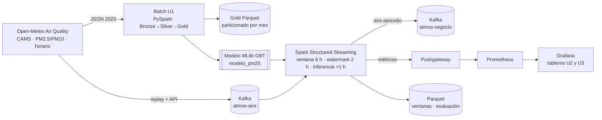
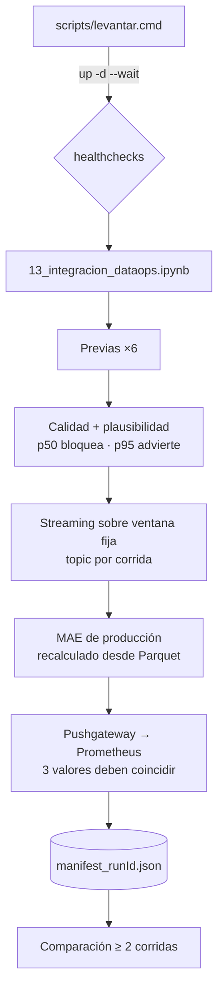

# 4. Arquitectura

## Elección: Lambda
Se eligió **Lambda** (batch + speed) y no Kappa porque hay un histórico anual (8 760 h) que se procesa por lotes para entrenar y auditar, y a la vez un flujo continuo que exige respuesta por evento. El costo asumido es mantener dos rutas; se mitiga con **una sola función de features** (`aire_comun.features`) usada por ambas (sin *training-serving skew*).

## Diagrama (nivel 1)


## Nivel 2: capa de integración y DataOps (U3)


## Componentes y decisiones
| Capa | Componente | Versión | Decisión técnica |
|---|---|---|---|
| Ingesta | Kafka (KRaft, 1 nodo) | apache/kafka 4.3.1 | sin ZooKeeper; 1 broker basta para un sensor lógico |
| Procesamiento | Spark Structured Streaming | 4.2.0 | ventana fija 6 h + watermark 2 h; `foreachBatch` para inferencia |
| ML | Spark MLlib GBTRegressor | 4.2.0 | pérdida absoluta; objetivo = delta a +1 h |
| Almacenamiento | Parquet | — | Gold particionado por `mes`; ventanas y evaluación en Parquet |
| Métricas | Pushgateway → Prometheus | v1.11.0 → v3.14.0 | el job de Spark es efímero: se **empuja**, no se scrapea |
| Tableros | Grafana | 11.4.0 | un tablero por unidad |
| Mensajería de negocio | topic `atmos-negocio` | — | evento `aire.episodio` separado del dato crudo |

## Carpetas principales
```
kafka/            compose de Kafka + exporter + Kafka UI (healthchecks)
obs/              compose de Prometheus + Pushgateway + Grafana, prometheus.yml, alerts.yml
pyspark/          unión del contenedor de Spark a la red de Kafka
s12-aire/         scripts, modelo, datos y tablero de U2 (aire)
u1-aire/          notebooks y decks de U1; u1-aire_corrida/ = evidencia ejecutada
u3-integracion/   cuaderno 13, tablero U3
scripts/          levantar / probar_salud / crear_topicos / resumen_manifiestos
docs/             este sitio (MkDocs)
```
