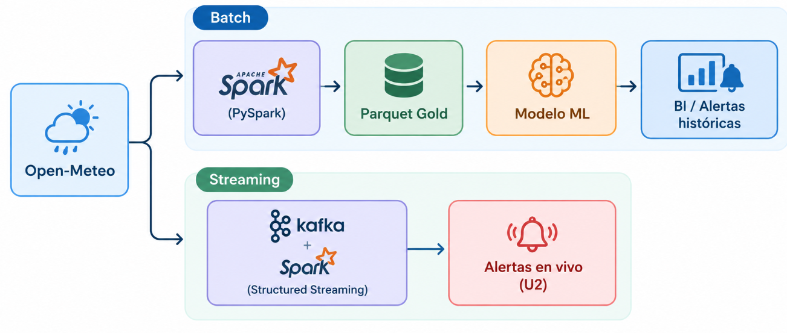
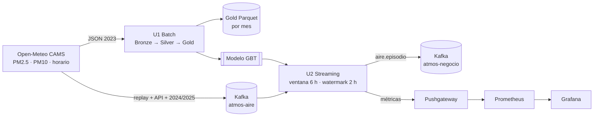

# Arquitectura Lambda – EcoData

## Decisión
Se seleccionó la **arquitectura Lambda**.

## Justificación
El proyecto requiere dos capacidades simultáneas:

- **Capa Batch (Unidad 1):** análisis histórico y entrenamiento de modelos.
- **Capa Speed (Unidad 2):** alertas en tiempo casi real.

Lambda permite mantener ambas rutas separadas, alimentadas por la misma fuente (Open-Meteo).

   

## Componentes de la ruta Batch (Unidad 1)
- Extracción desde Open-Meteo
- Limpieza y controles de calidad
- Escritura en Parquet particionado
- Entrenamiento y comparación de modelos con Spark MLlib

## Componentes de la ruta Speed (Unidad 2)
- Productor Python (`openmeteo_a_kafka.py`) hacia Kafka (`atmos-aire`, `atmos-negocio`)
- Spark Structured Streaming: ventana de 6 h, watermark de 2 h, checkpoint, inferencia a +1 h
- Pushgateway → Prometheus (5 alertas) → Grafana (16 paneles)

## Componentes y decisiones
| Capa | Componente | Versión | Decisión técnica |
|---|---|---|---|
| Ingesta | Kafka (KRaft, 1 nodo) | apache/kafka 4.3.1 | Sin ZooKeeper; un broker basta para un sensor lógico |
| Procesamiento | Spark Structured Streaming | 4.2.0 | Ventana fija 6 h + watermark 2 h; `foreachBatch` para inferencia |
| ML | Spark MLlib `GBTRegressor` | 4.2.0 | Pérdida absoluta; objetivo = variación a +1 h |
| Almacenamiento | Parquet | — | Gold particionado por `mes` |
| Métricas | Pushgateway → Prometheus | v1.11.0 → v3.14.0 | El job de Spark es efímero: se empuja, no se scrapea |
| Tableros | Grafana | 11.4.0 | `S12 - Calidad del aire` y tablero de integración |

## Por qué Lambda y no Kappa
Hay un histórico anual que se procesa por lotes para entrenar y auditar, y a la vez un flujo continuo que exige respuesta por evento. Lambda permite comparar el MAE de prueba del batch con el MAE en vivo. Se mitiga el costo de dos rutas con **una sola función de features** (`aire_comun.features`) usada por ambas.
