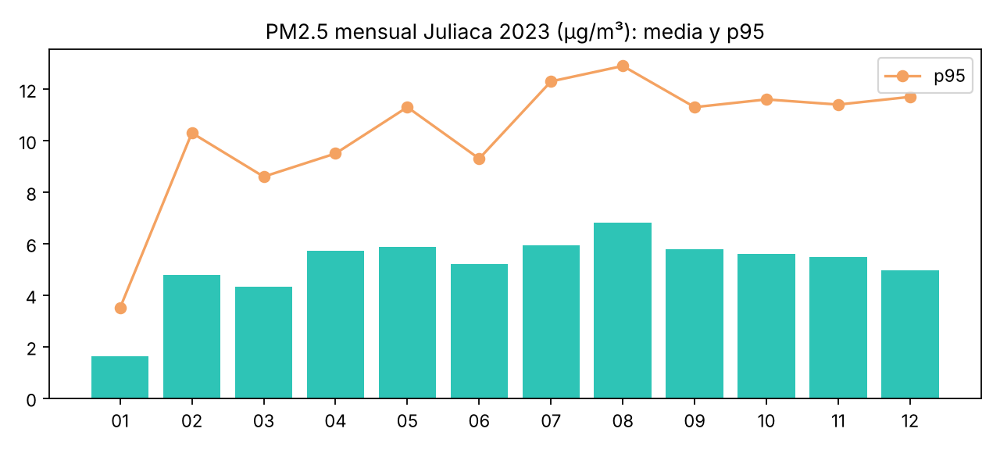
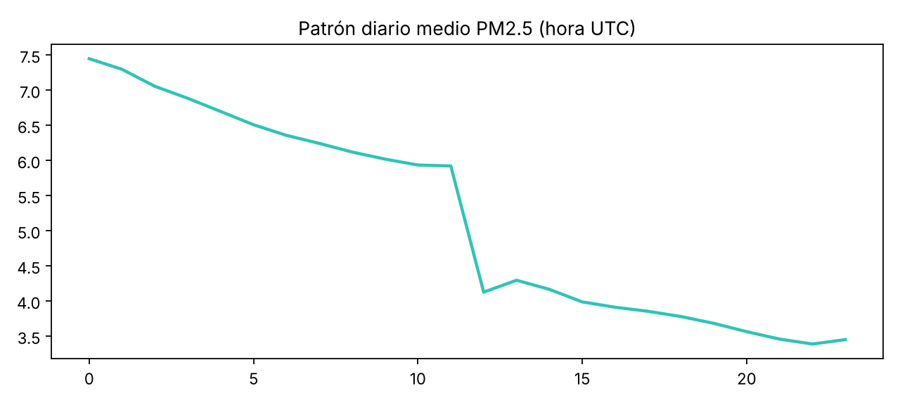
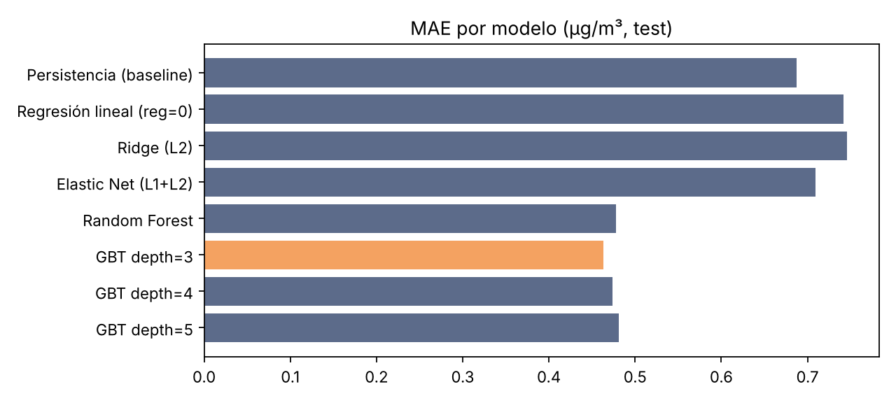

# Dimensión Aire (Lanzeloth) · U1 ampliada con un año de histórico

## Enfoque
La primera corrida de la U1 usó 2 328 horas (28/05–01/09/2026) y concluyó que la regresión lineal era el mejor modelo. Esta versión repite el mismo pipeline (Bronze → Silver → Gold Parquet → MLlib) sobre **un año completo (2023, 8 760 horas)**, el mismo histórico que alimenta el modelo de la Unidad 2.

## Pipeline y calidad
| Control | Antes | Después |
|---|---|---|
| Filas | 8 760 | 8 760 |
| Nulos (time, pm10, pm2_5) | 0 | 0 |
| Duplicados de `time` (Window + row_number) | 0 | 0 |
| Valores negativos | 0 | 0 |
| Huecos horarios (> 1 h) | — | 0 |
| pm2_5 > pm10 (redondeo del proveedor) | 12 | 12 (se conservan) |

Salida Gold: Parquet particionado por `mes` (12 particiones), lectura de vuelta con 8 760 filas y `PartitionFilters: [isnotnull(mes), (mes = 2023-06)]` en el plan.

## Indicador descriptivo
PM2.5 media anual 5,17 µg/m³ (máximo horario 35,2). Mes más alto: agosto (6,82); más bajo: enero (1,63). Ninguna hora llega a 50 µg/m³ y 13 horas superan 25 µg/m³. Con un solo año, la media mensual es una climatología de 2023, no una proyección multianual.

## Modelo (Spark MLlib)
Objetivo: PM2.5 de la hora siguiente, modelado como delta sobre el valor actual. Variables: `l0`, `d1`, `d3`, `d24`, `m24`, hora (seno/coseno) y PM10−PM2.5. Partición cronológica 80/20: 6 988 horas de entrenamiento y 1 747 de prueba (desde 20/10/2023).

| Modelo | RMSE | R² | MAE |
|---|---|---|---|
| Persistencia (base) | 1,5067 | 0,8478 | 0,6871 |
| Regresión lineal | 1,4185 | 0,8651 | 0,7419 |
| Ridge (L2) | 1,4374 | 0,8615 | 0,7459 |
| Elastic Net (L1+L2) | 1,4353 | 0,8619 | 0,7094 |
| Random Forest | 1,0727 | 0,9229 | 0,4780 |
| GBT profundidad 4 (cifra publicada en U2) | 1,0656 | 0,9239 | 0,4734 |
| **GBT profundidad 3 (ganador)** | **1,0498** | **0,9261** | **0,4635** |

El GBT gana en las tres métricas y reduce el MAE 32,5 % frente a la persistencia. El modelo guardado (`modelo_aire_u1`) se recargó y reproduce MAE 0,4635.

## De la primera U1 a esta versión
Con 4 meses el GBT sobreajustaba y ganaba la regresión lineal; con un año completo hay suficientes ciclos diarios y el GBT supera a todos. Los resultados originales se conservan en la página [Dimensión Aire (Lanzeloth)](dimension-lanzeloth.md).

## Reproducción
Notebooks en `u1/aire/`: `S2_aire_pyspark`, `S3_aire_calidad_parquet`, `S4_aire_modelo_mllib` (en ese orden) o `u1_aire_lanzeloth` (integrado). Datos: `aq_juliaca_2023.json`.
