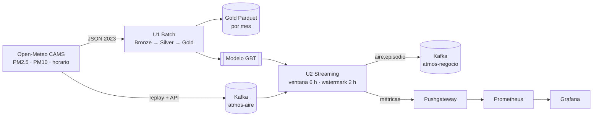

# EcoData Aire — Unidad 1 y 2

**Curso:** Big Data · UPeU, campus Juliaca · sección G1 · semestre 2026-2 · **Docente:** Abel Ángel Sullón Macalupú
**Autor:** Lanzeloth Vargas Marichi · **Repositorio:** [Lanzeloth03/lambda26-bigdata](https://github.com/Lanzeloth03/lambda26-bigdata)

## Problema
Juliaca no cuenta con un monitoreo accesible de material particulado (PM2.5 y PM10). EcoData Aire ingiere lecturas horarias, las valida, **pronostica el PM2.5 de la próxima hora** y avisa cuando se entra en un episodio de contaminación relativa.

## Solución en una línea
Una **arquitectura Lambda**: una capa batch (PySpark, Medallion, Parquet particionado por mes, modelo MLlib) y una capa de velocidad (Kafka + Spark Structured Streaming con el mismo modelo), observada con Pushgateway, Prometheus y Grafana.

!!! warning "Honestidad sobre el dato"
    La fuente es **PM2.5/PM10 modelado por CAMS** en una grilla de ≈ 45 km, no una estación física. Sirve para validar la arquitectura y el modelo; **no para vigilancia sanitaria**.

## Pregunta central
> ¿Un modelo entrenado con las últimas horas de PM2.5 y PM10 de Juliaca predice el PM2.5 de la próxima hora **mejor que repetir la última hora** (persistencia)?

## Respuesta medida
| Escenario | MAE modelo | MAE persistencia | Mejora |
|---|---|---|---|
| U1 · batch, prueba cronológica (1 747 h) | **0,4635** µg/m³ | 0,6871 | **−32,5 %** |
| U2 · streaming en vivo (761 h) | **0,422** µg/m³ | 0,567 | **−25,5 %** |
| Integración · corrida con 19 compuertas (143 h) | **0,4551** µg/m³ | 0,6524 | **−30,2 %** |

## Mapa del sitio
| Quiero… | Ir a |
|---|---|
| Ver el alcance, dominio y fichas | [Brief técnico-analítico](brief.md) |
| Ver el pipeline batch y sus resultados | [Producto U1](u1/producto.md) · [Arquitectura](u1/arquitectura.md) · [Dimensión Aire](u1/dimension-aire.md) · [Resultados](u1/resultados.md) |
| Ver el sistema en tiempo real | [Producto U2](u2/producto.md) · [Dimensión Aire](u2/dimension-aire.md) |
| Entender operación, costos y alertas | [Operación y costos](u2/operacion.md) · [Observabilidad](u2/observabilidad.md) · [Contrato de eventos](u2/contrato-eventos.md) |
| Prepararme para la sustentación | [Preparación S12](u2/preparacion-s12.md) |
| Ver pruebas con capturas | [Evidencias](u2/evidencias.md) · [Limitaciones y mejoras](u2/limitaciones.md) |
