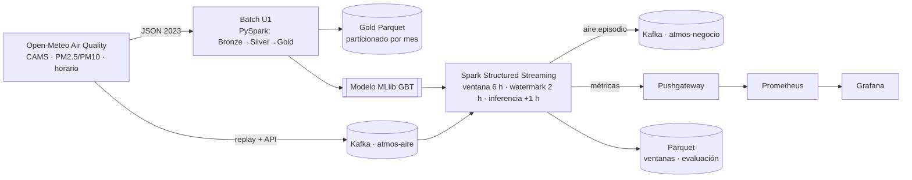

# Arquitectura

## Por qué Lambda y no Kappa
Hay un **histórico anual** (8 760 h) que conviene procesar por lotes para entrenar y auditar, y a la vez un **flujo continuo** que exige respuesta por evento. Lambda permite medir el MAE de prueba del batch frente al MAE en vivo. El costo asumido es mantener dos rutas; se mitiga con **una sola función de features** (`aire_comun.features`) que usan ambas, así no hay *training-serving skew*.

| | Lambda (elegida) | Kappa |
|---|---|---|
| Rutas | Batch + speed | Solo streaming |
| Histórico | Reproducible por lotes | Se reprocesa desde el log |
| Comparación batch vs vivo | Directa | No independiente |
| Costo | Dos rutas que mantener | Una ruta, pero sin el contraste que pide el curso |

## Diagrama


## Componentes y decisiones
| Capa | Componente | Versión | Decisión técnica |
|---|---|---|---|
| Ingesta | Kafka (KRaft, 1 nodo) | apache/kafka 4.3.1 | Sin ZooKeeper; un broker basta para un sensor lógico |
| Procesamiento | Spark Structured Streaming | 4.2.0 | Ventana fija 6 h + watermark 2 h; `foreachBatch` para inferencia |
| ML | Spark MLlib `GBTRegressor` | 4.2.0 | Pérdida absoluta; objetivo = delta a +1 h |
| Almacenamiento | Parquet | — | Gold particionado por `mes`; ventanas y evaluación en Parquet |
| Métricas | Pushgateway → Prometheus | v1.11.0 → v3.14.0 | El job de Spark es efímero: se **empuja**, no se scrapea |
| Tableros | Grafana | 11.4.0 | Tablero `S12 – Calidad del aire` |

## Carpetas principales
```
kafka/       compose de Kafka + exporter + Kafka UI (con healthchecks)
obs/         Prometheus + Pushgateway + Grafana, prometheus.yml, alerts.yml
pyspark/     contenedor de Spark unido a la red de Kafka
s12-aire/    scripts, modelo, datos y tablero de la Unidad 2
u1-aire/     cuadernos y presentaciones de la Unidad 1
u1-aire_corrida/  evidencia ejecutada (Gold, modelo, figuras)
scripts/     arranque, demo, carga de histórico
docs/        este sitio (MkDocs)
```
