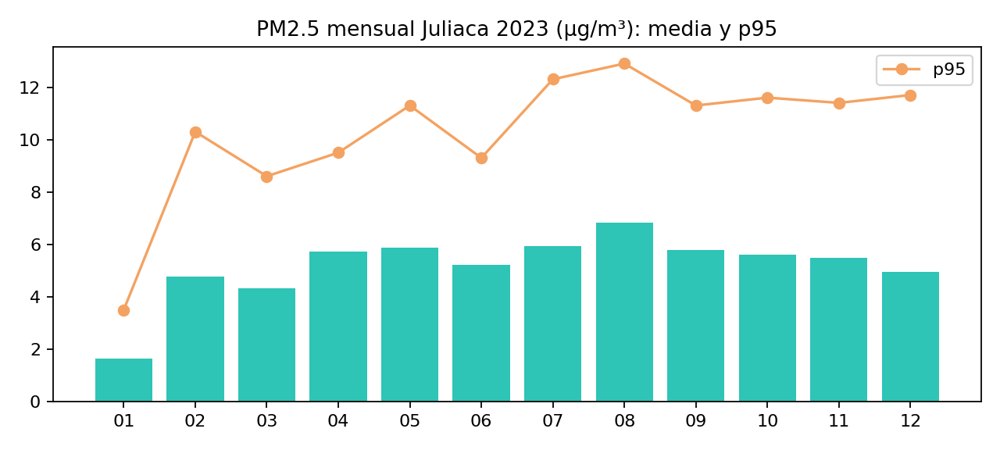
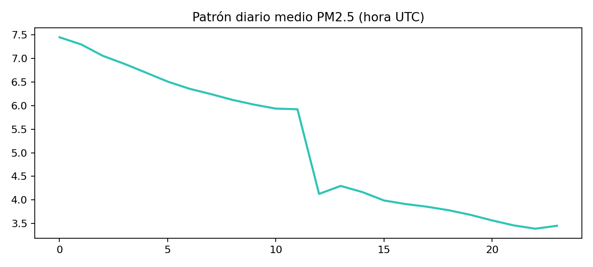

# Dimensión Aire — Unidad 1

## Enfoque
Análisis y pronóstico de la calidad del aire (PM2.5 y PM10) en Juliaca a partir del histórico horario de Open-Meteo (modelo CAMS), con el objetivo de **pronosticar el PM2.5 de la hora siguiente**.

## Pregunta de la dimensión
¿Cómo se comportan los indicadores de contaminación y qué tan bien se puede anticipar el PM2.5 de la próxima hora con un modelo batch?

## Pipeline realizado
1. Extracción del JSON horario de Open-Meteo (`aq_juliaca_2023.json`, punto −15,5 / −70,13).
2. Limpieza y controles de calidad: nulos, duplicados, negativos y continuidad horaria.
3. Escritura del Gold en Parquet **particionado por `mes`**.
4. Construcción de features con `aire_comun.features` y entrenamiento de 8 modelos con MLlib (objetivo: variación de PM2.5 a +1 h).
5. Comparación contra la persistencia y guardado del ganador.

## Datos y calidad
| Característica | Valor |
|---|---|
| Fuente | Open-Meteo Air Quality (modelo CAMS), variables `pm2_5` y `pm10`, zona GMT |
| Periodo | Año 2023 completo |
| Filas | 8 760 (365 × 24), sin huecos |
| PM2.5 | media 5,17 · mediana 4,80 · p95 10,80 · máx 35,2 µg/m³ |
| PM10 | mediana 7,10 · p95 16,10 µg/m³ |
| Excedencias del ECA peruano | 0 h en PM2.5 y PM10; guía OMS PM10 (45 µg/m³): 4 h |
| Calidad | Sin duplicados, sin negativos, continuidad horaria ≥ 99 % |
| Partición Parquet | `mes=2023-01` … `mes=2023-12` (12) |

La partición por mes se comprobó con el plan de ejecución: consultar un mes lee solo esa partición (*PartitionFilters*).

### Perfil mensual
| Mes | Horas | PM2.5 media | PM2.5 p95 | PM2.5 máx | PM10 media |
|---|---|---|---|---|---|
| 2023-01 | 744 | 1,63 | 3,5 | 5,8 | 2,40 |
| 2023-02 | 672 | 4,77 | 10,3 | 13,5 | 6,84 |
| 2023-03 | 744 | 4,33 | 8,6 | 11,6 | 6,26 |
| 2023-04 | 720 | 5,73 | 9,5 | 16,4 | 8,31 |
| 2023-05 | 744 | 5,87 | 11,3 | 21,6 | 8,57 |
| 2023-06 | 720 | 5,21 | 9,3 | 12,3 | 7,61 |
| 2023-07 | 744 | 5,94 | 12,3 | 17,8 | 8,70 |
| 2023-08 | 744 | 6,82 | 12,9 | 32,7 | 10,03 |
| 2023-09 | 720 | 5,79 | 11,3 | 35,2 | 8,46 |
| 2023-10 | 744 | 5,61 | 11,6 | 24,6 | 8,16 |
| 2023-11 | 720 | 5,48 | 11,4 | 27,6 | 8,08 |
| 2023-12 | 744 | 4,95 | 11,7 | 17,0 | 8,13 |

**Lectura.** Enero es el mes más limpio (PM2.5 medio 1,63) y agosto el de mayor concentración y picos (máximo 32,7 en agosto y 35,2 en septiembre). Hay estacionalidad: por eso el modelo se evalúa con una partición cronológica y no aleatoria.

## Niveles de alerta
La norma peruana nunca se excedió en 2023, así que un umbral absoluto casi no tendría casos. Se define un **episodio relativo**: PM2.5 mayor que el percentil 95 del entrenamiento (**10,5 µg/m³**).

## Features (8)
| Feature | Significado |
|---|---|
| `l0` | PM2.5 actual |
| `d1`, `d3`, `d24` | Diferencia de PM2.5 con 1, 3 y 24 h atrás |
| `m24` | Media de las últimas 24 h menos el valor actual |
| `pm10d` | Diferencia PM10 − PM2.5 actual |
| `hs`, `hc` | Seno y coseno de la hora del día objetivo |

## Reproducción
Cuadernos `u1-aire_corrida/S2…S4` y `u1_aire_lanzeloth.ipynb`; función de features en `s12-aire/scripts/aire_comun.py`.
