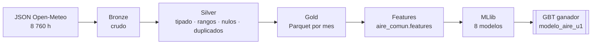

# Producto Unidad 1 — Batch distribuido (Aire)

La Unidad 1 construye la **capa batch** de la arquitectura Lambda: toma el año 2023 completo de PM2.5/PM10 de Juliaca, lo limpia con PySpark, lo guarda como Parquet particionado y entrena el modelo que luego usa la Unidad 2.

## Cumplimiento de la unidad
| Requisito U1 | Cómo se cumple | Evidencia |
|---|---|---|
| Problema delimitado y arquitectura justificada | Lambda; pregunta de pronóstico a +1 h | [Arquitectura](arquitectura.md), `EcoData_S1_Arquitectura_Aire.pptx` |
| Pipeline con Spark: extracción, transformaciones, agregaciones y calidad | S2 (transformaciones, *lazy evaluation*) y S3 (calidad y Parquet) | `u1-aire_corrida/S2_aire_pyspark.ipynb`, `S3_aire_calidad_parquet.ipynb` |
| Salida analítica en Parquet particionada | Gold particionado por `mes` (12 particiones) | `u1-aire_corrida/gold/` |
| Modelo de regresión distribuido | S4: persistencia, lineal, Ridge, Elastic Net, Random Forest y GBT (profundidad 3, 4 y 5) | `u1-aire_corrida/fig/metricas.csv` |
| Comparación contra una línea base | Persistencia (la próxima hora igual a la actual) | [Resultados](resultados.md) |

## Flujo del pipeline

## Cuadernos
| Sesión | Cuaderno | Qué demuestra |
|---|---|---|
| S2 | `S2_aire_pyspark.ipynb` | DataFrames, transformaciones, evaluación perezosa |
| S3 | `S3_aire_calidad_parquet.ipynb` | Reglas de calidad y escritura Parquet particionada |
| S4 | `S4_aire_modelo_mllib.ipynb` | Comparación de modelos con MLlib |
| Integrado | `u1_aire_lanzeloth.ipynb` | Todo el flujo en un solo cuaderno ejecutado |

Los cuadernos ejecutados, con sus salidas, están en `u1-aire_corrida/`.
