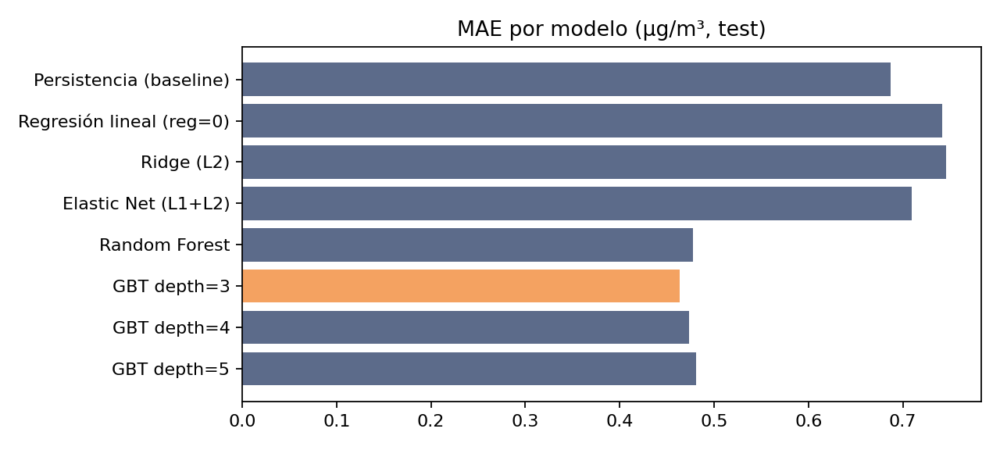

# Resultados — Unidad 1

**Partición cronológica:** entrena hasta 2023-10-19 (6 988 filas) y prueba desde 2023-10-20 (1 747 filas). Nunca aleatoria: es una serie de tiempo.

## Comparación de modelos (prueba de 1 747 h)
| Modelo | RMSE | MAE | R² |
|---|---|---|---|
| Persistencia (línea base) | 1,5067 | 0,6871 | 0,8478 |
| Regresión lineal | 1,4185 | 0,7419 | 0,8651 |
| Ridge (L2) | 1,4374 | 0,7459 | 0,8615 |
| Elastic Net | 1,4353 | 0,7094 | 0,8619 |
| Random Forest | 1,0727 | 0,4780 | 0,9229 |
| **GBT profundidad 3 (ganador)** | **1,0498** | **0,4635** | **0,9261** |
| GBT profundidad 4 | 1,0656 | 0,4734 | 0,9239 |
| GBT profundidad 5 | 1,1322 | 0,4813 | 0,9141 |

## Lectura honesta
- Los modelos **lineales no superan** a la persistencia en MAE (0,74 vs 0,69): minimizan el error cuadrático y los picos los penalizan.
- Los modelos de árboles capturan la no linealidad y reducen el MAE a 0,46–0,48.
- El **GBT de profundidad 3** gana: MAE **0,4635 vs 0,6871**, una mejora de **32,5 %**.
- Hay una gama de profundidades casi equivalente (3, 4 y 5): la ganancia no depende de un ajuste fino.

## Qué pasa con U2
La Unidad 2 usa un GBT reentrenado por `entrenar_pm25.py` (profundidad 4, pérdida absoluta, 80 iteraciones) con la **misma función de features**; en la misma prueba logra 0,473 vs 0,687 (−31,1 %). Ver [Dimensión Aire — U2](../u2/dimension-aire.md).
