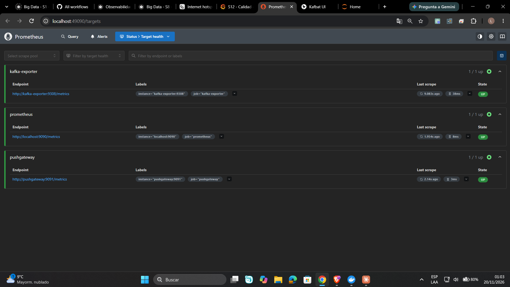
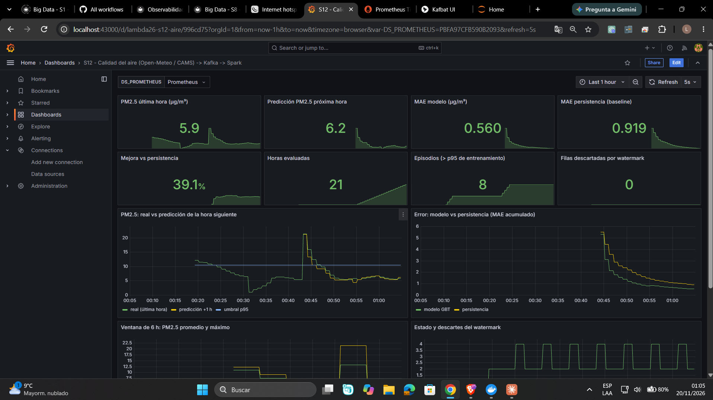

# Evidencias de la Unidad 2

Capturas tomadas el **20/11/2026** sobre el pipeline en ejecución (Open-Meteo → Kafka → Spark Structured Streaming → Pushgateway → Prometheus → Grafana). Cada bloque indica el criterio de la rúbrica que respalda.

## Plataforma sana
**Contenedores en Docker con healthcheck.** Kafka, Kafka UI, kafka-exporter, Pushgateway, Prometheus, Grafana y Spark en estado `(healthy)`.

## 1 y 2. Ingesta con Kafka (eventos empresariales y de sensor)

**Topics del pipeline en Kafka UI.** `atmos-aire` con la telemetría, `atmos-negocio` con los episodios y los topics de demostración e histórico, con 1 partición y factor de replicación 1.

**Un mensaje abierto de `atmos-aire`.** Se ve la clave (`openmeteo-cams-juliaca`), el contrato JSON (`tipoEvento`, `sensorId`, `pm25`, `pm10`, `origen`, `timestamp`) y el tamaño real del evento (150 bytes). Esquema versionado en [Contrato de eventos](contrato-eventos.md).

## Unidad 1 · Batch
**Métricas del batch y particiones por mes.**

## 3. Streaming con Spark

**Watermark en acción.** Al publicar con `--tardio 30`, el evento llega fuera del watermark de 2 h y Spark lo descarta y lo cuenta: el panel «Filas descartadas por watermark» sube y se dispara la alerta informativa `DescartesPorWatermarkCreciendo`.

## 4. Observabilidad

**Prometheus: targets.** `pushgateway`, `kafka-exporter` y `prometheus` en estado UP.

**Correlación: la fuente se detiene → frescura → alerta.** Al dejar de llegar datos, «Segundos desde el último push» supera los 600 s, el semáforo pasa a rojo y se dispara `AireSinEventosNuevos`; al publicar de nuevo se recupera.

## 5. Costos y escalado

Volúmenes medidos, tarifas y ruta de crecimiento en [Operación, escalado y costos](operacion.md).

## 6 y 7. Salidas BI/ML e inferencia validada

**Predicción de PM2.5 a +1 h.** Con 2,50 µg/m³ a las 19:00 UTC, el modelo GBT predice un delta de +0,07 y 2,57 µg/m³ para la hora siguiente, lejos del umbral de episodio (10,5 µg/m³, el p95 del entrenamiento).

**Tablero de Grafana, parte superior.** PM2.5 real contra predicción, MAE del modelo frente a la persistencia y mejora acumulada.

**Tablero de Grafana, parte inferior.** Watermark, filas descartadas, estado de la consulta y mensajes en Kafka.

