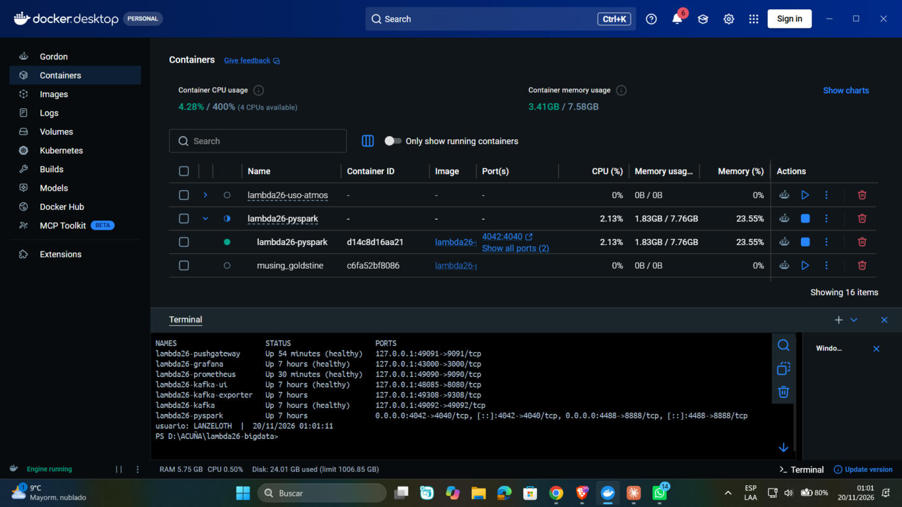
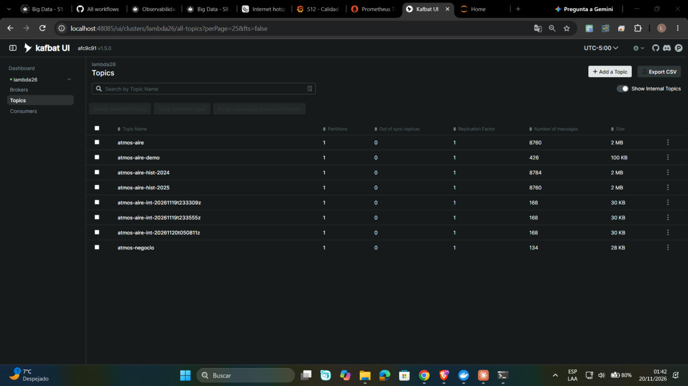
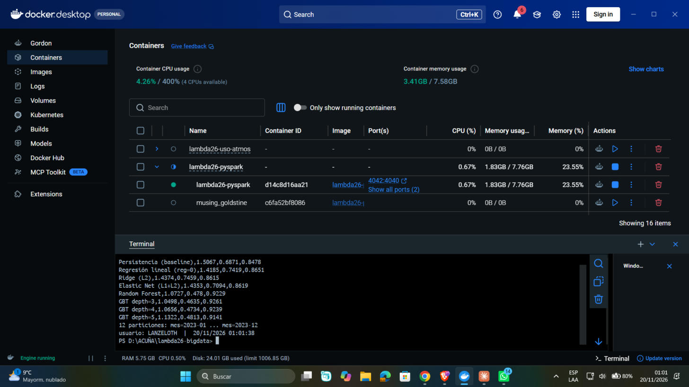
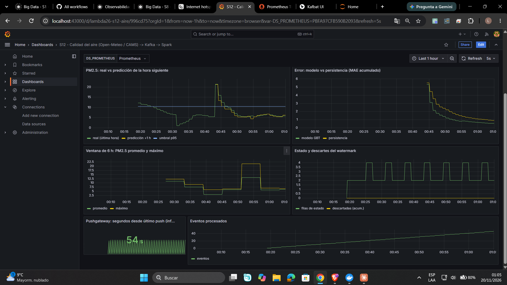

# Evidencias

Capturas tomadas el 20/11/2026 sobre el pipeline en ejecución (Open-Meteo → Kafka → Spark Structured Streaming → Pushgateway → Prometheus → Grafana). Cada bloque indica el criterio de la rúbrica que respalda.

!!! note "Nota sobre las cifras"
    Los contadores acumulados (eventos procesados, horas evaluadas, filas descartadas, mensajes por topic) incluyen las reproducciones (*replay*) de la demostración y el histórico real de 2024 y 2025 cargado a Kafka; no equivalen a horas distintas del año 2023. Las métricas de error (MAE) son las comparables.

## Plataforma sana
**Contenedores en Docker con healthcheck.** Kafka, Kafka UI, kafka-exporter, Pushgateway, Prometheus, Grafana y Spark en estado `(healthy)`.

## 1 y 2. Ingesta con Kafka (eventos de negocio y de sensor)
**Topics en Kafka UI.** `atmos-aire` con la telemetría, `atmos-negocio` con los episodios, y los topics de demostración e histórico (`atmos-aire-demo`, `atmos-aire-hist-2024`, `atmos-aire-hist-2025`), con 1 partición y factor de replicación 1. En total, alrededor de 27 000 mensajes.

## Unidad 1 · Batch
**Métricas del batch y particiones por mes.** Comparación de modelos con el GBT ganador y el Gold Parquet con sus 12 particiones.

## 4. Observabilidad
**Prometheus: targets.** Pushgateway, kafka-exporter y Prometheus en estado UP.

## 6 y 7. Salidas BI/ML e inferencia validada
**Grafana, parte superior.** Estado del job, PM2.5 y predicción a +1 h, MAE del modelo frente a la persistencia y mejora acumulada.

**Grafana, parte inferior.** Watermark, filas descartadas, estado de la consulta y mensajes en Kafka.

## 3. Streaming con Spark: cómo reproducir la prueba del watermark
1. Publicar un evento atrasado: `--tardio 30` envía una lectura con 30 h de retraso (`origen = demo-tardio`).
2. Spark la descarta por estar fuera del watermark de 2 h y la cuenta: sube «Filas descartadas por watermark».
3. Se dispara la alerta informativa `DescartesPorWatermarkCreciendo`.

## Integración (corridas con compuertas)
Dos corridas reproducibles con 19 compuertas cada una (previas, calidad, plausibilidad, streaming y observabilidad), con el mismo resultado: 143 h evaluadas, MAE 0,4551 vs 0,6524 (−30,2 %), 19/19 compuertas OK. El MAE del job, el de Pushgateway, el de Prometheus y el recalculado desde Parquet coinciden. Detalle en `u3-integracion/manifiestos/`.
