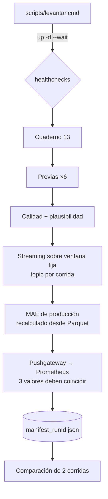

# Integración y compuertas de calidad

El cuaderno de integración (`u3-integracion/13_integracion_dataops.ipynb`) ejecuta el sistema completo de punta a punta y comprueba, con **19 compuertas**, que cada etapa funcionó. Cada corrida deja un **manifiesto JSON** (`u3-integracion/manifiestos/manifest_<runId>.json`) y publica sus métricas en un job aparte (`lambda26_aire_int`) para no pisar el tablero de la demo.

## Corridas reales
| Corrida | Fuente | Horas evaluadas | MAE modelo | MAE persistencia | Mejora | Compuertas | Duración |
|---|---|---|---|---|---|---|---|
| `20261119T233309Z` | kafka | 143 | 0,4551 | 0,6524 | 30,25 % | **19/19** | 46,4 s |
| `20261119T233555Z` | kafka | 143 | 0,4551 | 0,6524 | 30,25 % | **19/19** | 41,3 s |

Las dos corridas son **idénticas en métrica**: no hay regresión.

## Las 19 compuertas
| Grupo | Compuertas | Qué comprueban |
|---|---|---|
| Previas (6) | P1–P6 | Kafka accesible, Pushgateway y Prometheus sanos, Prometheus scrapea al Pushgateway, modelo MLlib presente, datos fuente presentes |
| Calidad (3) | C1–C3 | Sin duplicados, sin negativos, continuidad horaria del 100 % |
| Plausibilidad (2) | PL1–PL2 | Mediana de PM2.5 en rango (p50 = 4,80) y p95 razonable (10,80); la mediana bloquea y el p95 advierte |
| Streaming (5) | S1–S5 | 168 eventos publicados; el streaming termina y reporta; horas evaluadas = 168 − 24 − 1; MAE del job = MAE recalculado desde Parquet; el modelo supera a la persistencia |
| Observabilidad (3) | O1–O3 | El job publicó `mae_modelo` en el Pushgateway; Prometheus devuelve el mismo valor; `n_evaluadas` coincide en los tres lados |

## Fallas demostradas a propósito
| Falla provocada | Resultado |
|---|---|
| Pushgateway en un puerto inexistente (9999) | La compuerta P2 **bloquea** la corrida, como se esperaba |
| Copia corrupta de los datos con horas duplicadas | La compuerta C1 **bloquea** la corrida, como se esperaba |

## Tablero U3 de integración
`u3-integracion/grafana/dashboard_u3_integracion.json`: 5 paneles de la última corrida (MAE modelo vs persistencia, mejora %, horas evaluadas, compuertas OK/total y duración).
