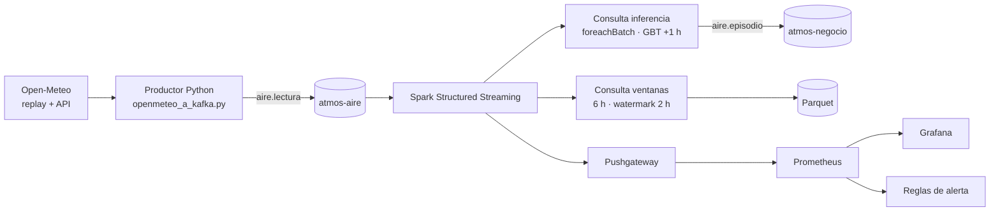

# Producto Unidad 2 — Sistema en tiempo real (resumen)

La Unidad 2 construye la **capa de velocidad**: los mismos datos llegan evento a evento por Kafka, Spark Structured Streaming los procesa con ventanas y watermark, el modelo pronostica el PM2.5 de la próxima hora y el estado del sistema se observa en Grafana.

## Pregunta de negocio
> ¿Un modelo entrenado con las últimas horas de PM2.5 y PM10 de Juliaca predice el PM2.5 de la próxima hora mejor que repetir la última hora (persistencia)?

**Por qué no «¿cuándo se superará el umbral?»:** en 2023 la norma peruana (ECA) nunca se excedió y la guía OMS de PM10 solo 4 h; esa pregunta casi no tiene casos positivos. Predecir la hora siguiente sí se puede medir en todas las horas. Alerta secundaria (relativa): *episodio* si PM2.5 > p95 de entrenamiento (10,5 µg/m³).

## Flujo del sistema

## Requisitos de la unidad y cómo se cumplen
| # | Requisito | Cómo se cumple | Dónde ver |
|---|---|---|---|
| 1 | Eventos empresariales con Kafka | `aire.episodio` en el topic `atmos-negocio` | [Contrato de eventos](contrato-eventos.md) |
| 2 | Eventos de sensores | `aire.lectura` en `atmos-aire`, clave `sensorId` | [Contrato de eventos](contrato-eventos.md) |
| 3 | Streaming con Spark | Ventana 6 h, watermark 2 h, checkpoint, `foreachBatch` idempotente | [Dimensión Aire](dimension-aire.md) |
| 4 | Observabilidad | Pushgateway → Prometheus → Grafana, 5 alertas, semáforo de frescura | [Observabilidad](observabilidad.md) |
| 5 | Costos y escalado | Volumen medido, escenarios y criterios de escalado | [Operación y costos](operacion.md) |
| 6 | Salidas BI/ML | Tablero Grafana de 16 paneles | [Evidencias](evidencias.md) |
| 7 | Inferencia validada | MAE del modelo vs persistencia, en vivo | [Dimensión Aire](dimension-aire.md) |
| 8 | Sustentación | Preguntas del jurado con respuesta | [Preparación S12](preparacion-s12.md) |

## Consultas de Spark
| Consulta | Qué hace |
|---|---|
| `ventanas` | Ventana fija de **6 h**, watermark **2 h**, modo *append*: n, PM2.5 promedio y máximo, PM10 promedio, horas sobre el umbral → Parquet |
| `inferencia` (`foreachBatch`) | Features de 24 h → GBT → predicción a +1 h; cuando llega la hora real calcula el error del modelo y el de la persistencia; emite `aire.episodio` |

Cada consulta tiene su propio **checkpoint** (`_ckpt/ventanas`, `_ckpt/inferencia`): si el job se reinicia retoma desde el último lote confirmado. El lote de inferencia es **idempotente**: un lote ya procesado se ignora.

## Resultados clave
| Medida | Valor |
|---|---|
| MAE en vivo (modelo vs persistencia) | **0,422 vs 0,567** µg/m³ (−25,5 %, 761 h evaluadas) |
| MAE en prueba cronológica del modelo de U2 | 0,473 vs 0,687 (−31,1 %) |
| Integración (143 h, 19/19 compuertas) | 0,4551 vs 0,6524 (−30,2 %) |
| Umbral de episodio | 10,5 µg/m³ (p95 de entrenamiento) |
