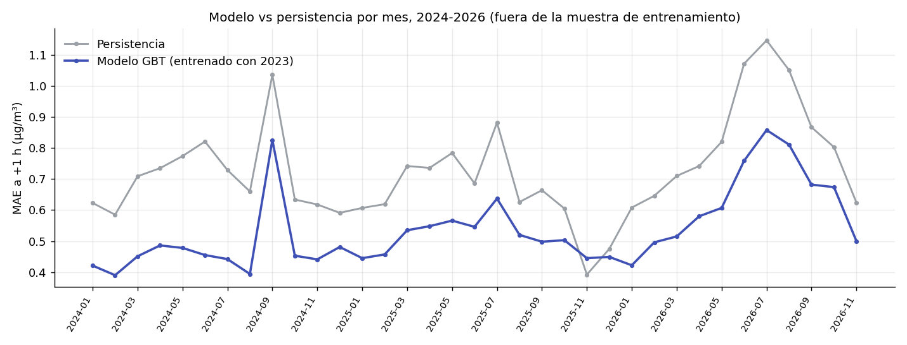
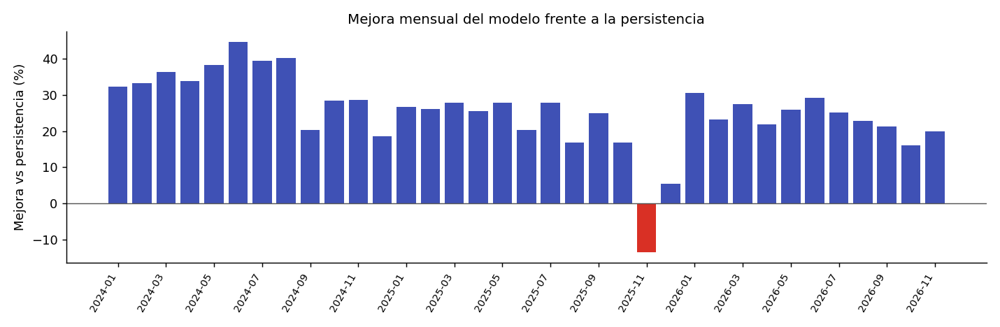

# Validación del modelo en 2024, 2025 y 2026

El modelo se entrenó **solo con 2023** (hasta el 19/10/2023). Para comprobar que no depende de ese año, se evaluó, sin reentrenar, sobre **datos reales posteriores** descargados de Open-Meteo (mismo punto de Juliaca, mismas variables, mismo modelo CAMS). Es una validación **fuera de muestra**: ninguna de estas horas se usó para entrenar.

## Método
- **Modelo:** el GBT guardado (`modelo_pm25`, profundidad 4, pérdida absoluta, 8 features).
- **Objetivo:** variación de PM2.5 a +1 h; la predicción es `PM2.5(t) + delta`.
- **Comparación:** contra la persistencia (la próxima hora igual a la actual), con la misma métrica (MAE, µg/m³).
- **Reproducción:** `scripts\evaluar_anios.cmd` (usa `s12-aire/scripts/evaluar_anios.py`); el resultado queda en `s12-aire/eval_anios.json`.

## Resultado por año
| Año | Horas con dato | Horas evaluadas | PM2.5 media | PM2.5 máx | MAE modelo | MAE persistencia | Mejora |
|---|---|---|---|---|---|---|---|
| 2023 (prueba cronológica, últimos 2,5 meses) | 8 760 | 1 747 | 5,17 | 35,2 | 0,473 | 0,687 | **31,1 %** |
| **2024** | 8 784 | 8 759 | 5,34 | 32,1 | **0,4762** | 0,7095 | **32,9 %** |
| **2025** | 8 760 | 8 735 | 4,55 | 20,2 | **0,5130** | 0,6522 | **21,3 %** |
| **2026** (1 ene – 20 nov) | 7 776 | 7 751 | 5,25 | 64,0 | **0,6335** | 0,8349 | **24,1 %** |

## Lectura
- **El modelo generaliza:** gana a la persistencia en los tres años (−32,9 % en 2024, −21,3 % en 2025 y −24,1 % en 2026), con un error absoluto de 0,48 a 0,63 µg/m³.
- **Gana en 34 de los 35 meses** evaluados; la única excepción es **noviembre de 2025**, donde la persistencia fue mejor (MAE 0,445 frente a 0,392).
- **Hay deriva moderada:** la mejora de 2025 (21,3 %) es menor que la de 2024 (32,9 %) y la de 2023 (31,1 %). Es la señal que justifica el reentrenamiento periódico que se propone en [Limitaciones y mejoras](limitaciones.md).
- **2026 es el año más exigente:** el máximo llega a 64,0 µg/m³ (más del doble que en 2023) y el MAE de la persistencia sube a 0,83; aun así el modelo mantiene una ventaja de 24,1 %.

## Detalle mensual
### 2024
| Mes | Horas | MAE modelo | MAE persistencia | Mejora |
|---|---|---|---|---|
| 2024-01 | 720 | 0,421 | 0,623 | 32,3 % |
| 2024-02 | 696 | 0,390 | 0,585 | 33,3 % |
| 2024-03 | 744 | 0,451 | 0,709 | 36,5 % |
| 2024-04 | 720 | 0,486 | 0,735 | 33,9 % |
| 2024-05 | 744 | 0,478 | 0,774 | 38,3 % |
| 2024-06 | 720 | 0,455 | 0,821 | 44,6 % |
| 2024-07 | 744 | 0,442 | 0,729 | 39,4 % |
| 2024-08 | 744 | 0,394 | 0,660 | 40,3 % |
| 2024-09 | 720 | 0,826 | 1,036 | 20,2 % |
| 2024-10 | 744 | 0,453 | 0,634 | 28,6 % |
| 2024-11 | 720 | 0,441 | 0,618 | 28,7 % |
| 2024-12 | 743 | 0,481 | 0,591 | 18,6 % |

### 2025
| Mes | Horas | MAE modelo | MAE persistencia | Mejora |
|---|---|---|---|---|
| 2025-01 | 720 | 0,445 | 0,607 | 26,7 % |
| 2025-02 | 672 | 0,457 | 0,619 | 26,2 % |
| 2025-03 | 744 | 0,535 | 0,742 | 28,0 % |
| 2025-04 | 720 | 0,548 | 0,736 | 25,5 % |
| 2025-05 | 744 | 0,566 | 0,784 | 27,8 % |
| 2025-06 | 720 | 0,546 | 0,686 | 20,4 % |
| 2025-07 | 744 | 0,637 | 0,882 | 27,8 % |
| 2025-08 | 744 | 0,520 | 0,626 | 16,9 % |
| 2025-09 | 720 | 0,498 | 0,664 | 25,1 % |
| 2025-10 | 744 | 0,503 | 0,605 | 16,8 % |
| 2025-11 | 720 | 0,445 | 0,392 | **-13,6 %** |
| 2025-12 | 743 | 0,449 | 0,475 | 5,6 % |

### 2026
| Mes | Horas | MAE modelo | MAE persistencia | Mejora |
|---|---|---|---|---|
| 2026-01 | 720 | 0,422 | 0,608 | 30,5 % |
| 2026-02 | 672 | 0,496 | 0,646 | 23,3 % |
| 2026-03 | 744 | 0,515 | 0,710 | 27,4 % |
| 2026-04 | 720 | 0,580 | 0,742 | 21,9 % |
| 2026-05 | 744 | 0,607 | 0,820 | 26,0 % |
| 2026-06 | 720 | 0,759 | 1,072 | 29,1 % |
| 2026-07 | 744 | 0,858 | 1,147 | 25,2 % |
| 2026-08 | 744 | 0,811 | 1,051 | 22,8 % |
| 2026-09 | 720 | 0,682 | 0,867 | 21,3 % |
| 2026-10 | 744 | 0,674 | 0,803 | 16,1 % |
| 2026-11 | 479 | 0,500 | 0,624 | 19,8 % |

## Datos de 2026
Sí hay datos de 2026: la API de Open-Meteo devuelve la serie horaria desde el **01/01/2026 00:00** y se descargó hasta el **20/11/2026**. Los de 2026 se cargaron a Kafka en `atmos-aire-hist-2026` y se usaron para evaluar. Las últimas horas del día en curso son un pronóstico del propio modelo CAMS y no una observación consolidada.
