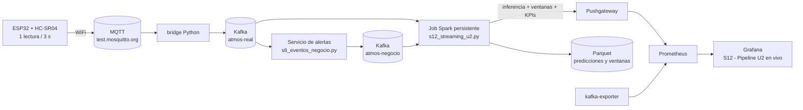

# Producto de Unidad 2 — Pipeline en tiempo real

**Autor:** Lanzeloth Vargas Marichi · **Curso:** Big Data 2026-2, UPeU · **Repositorio:** [lambda26-bigdata](https://github.com/Lanzeloth03/lambda26-bigdata)

Esta documentación describe **mi dimensión U2**: la capa en tiempo real del proyecto, construida con un **ESP32 físico + sensor ultrasónico HC-SR04** que publica una lectura de distancia cada ~3 s. El pipeline ingiere eventos de sensor y de negocio por Kafka, los procesa con Spark Structured Streaming (ventanas, watermark, checkpoint), aplica un modelo de series de tiempo a cada evento y publica métricas a Prometheus/Grafana.

## Arquitectura

## Qué evidencia cada criterio de la rúbrica

| # | Criterio | Peso | Evidencia | Dónde se ve en vivo |
|---|---|---|---|---|
| 1 | Eventos empresariales por Kafka | 12 % | `AlertaOperativa` y `OrdenMantenimiento` en `atmos-negocio` con contrato versionado | [Ingesta](ingesta.md#eventos-de-negocio-s6) · consumidor en consola · panel «Eventos de negocio» |
| 2 | Eventos IoT/sensores | 10 % | ESP32 → MQTT → Kafka `atmos-real`, esquema y volumen medidos | [Ingesta](ingesta.md#eventos-iot-s7) · Kafka UI |
| 3 | Spark Structured Streaming | 14 % | Ventana de 1 min + watermark 30 s + checkpoint, job persistente | [Streaming](streaming.md) · panel «Ventanas, watermark y checkpoint» |
| 4 | Observabilidad | 12 % | Panel con métricas de Kafka y Spark correlacionadas, alertas con umbrales medidos | [Observabilidad](observabilidad.md) |
| 5 | Costos y escalado | 8 % | Estimación con volumen medido y plan por escalones | [Costos](costos.md) |
| 6 | Salidas BI/ML | 12 % | KPIs de flujo + predicción en el mismo tablero | [BI y KPIs](bi.md) |
| 7 | Serie de tiempo validada | 12 % | LR vs persistencia vs RandomForest con split cronológico; MAE en producción | [Modelo](modelo.md) |
| 8 | Sustentación | 20 % | Guion y demo ensayados | — |

## Evolución desde la Unidad 1

| | Unidad 1 | Unidad 2 |
|---|---|---|
| Tratamiento | Batch: se procesa el histórico completo | Streaming: se procesa cada evento al llegar |
| Herramienta | Notebooks PySpark + Parquet + MLlib | Job `spark-submit` persistente + Kafka |
| Modelo | Entrenado y evaluado una vez (foto fija) | Inferencia en vivo y error medido contra lo que llega después |
| Reporte | Tablas y gráficos en el notebook | Grafana, actualizándose cada 5 s |
